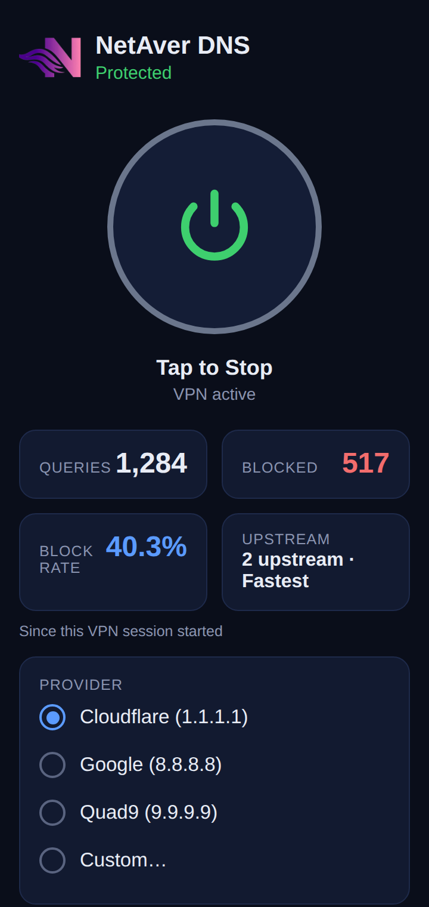
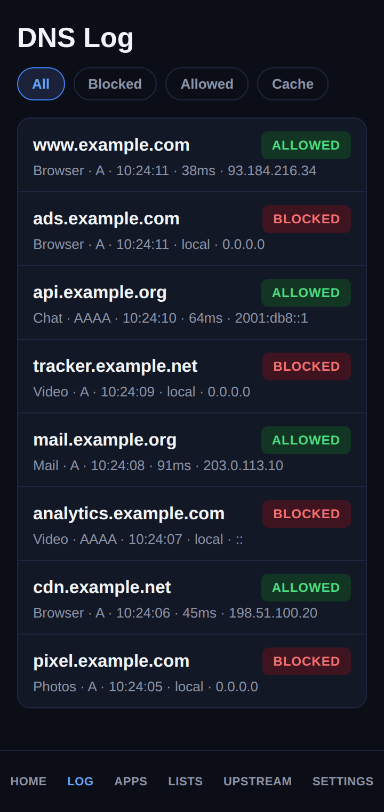
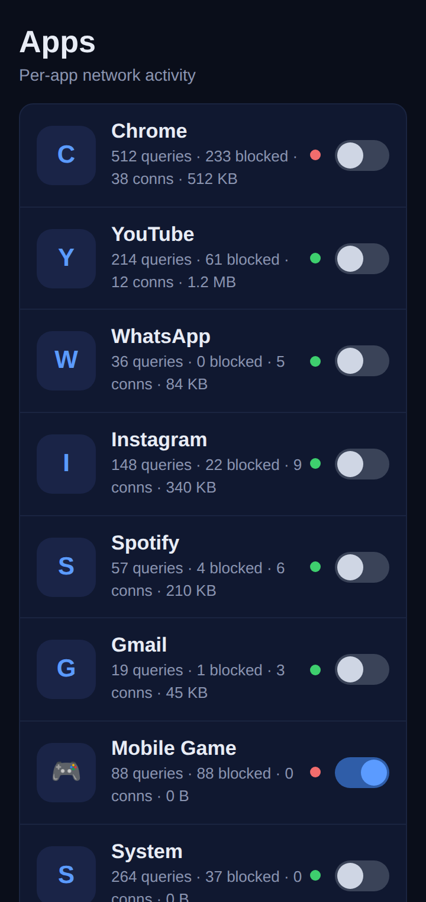
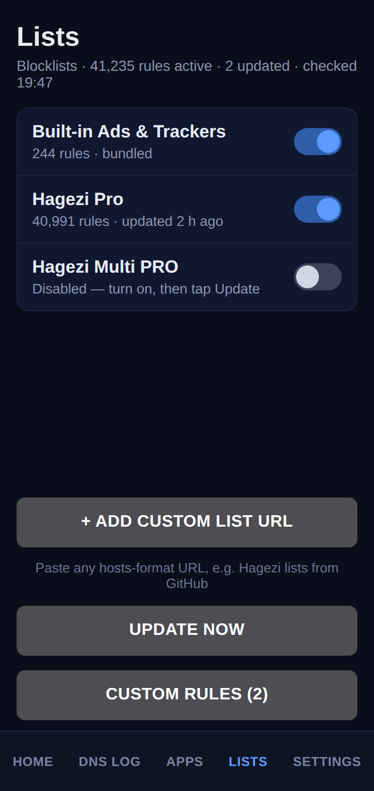
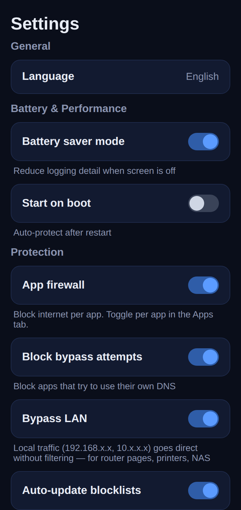
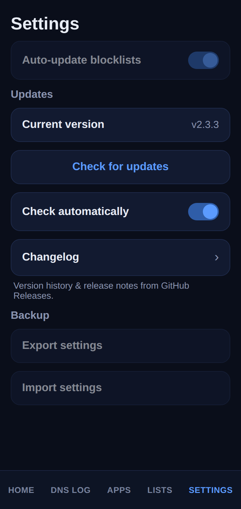
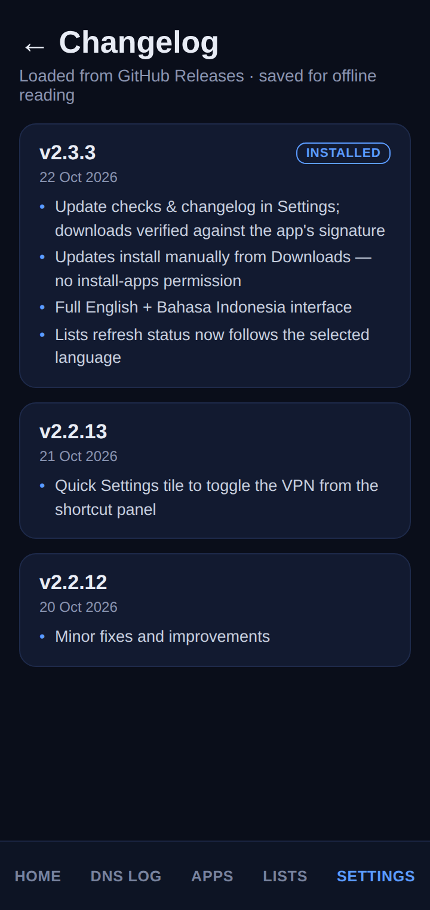

# NetAver DNS

**A lightweight DNS-based content filter for Android — no root, no account, no telemetry.**

NetAver DNS runs a local VPN service that intercepts DNS queries on your device,
checks them against blocklists, and forwards allowed queries to encrypted
upstreams (DNS-over-TLS / DNS-over-HTTPS). Ads, trackers and known-bad domains
stop resolving — for the whole device, in every app.

> Versi Bahasa Indonesia ada di bagian bawah.

## Why is this source published?

For **transparency**. NetAver DNS asks for VPN permission and sees every DNS
query on your device — you should not have to take the author's word that it
behaves. This repository contains the complete source so anyone can audit
exactly what the app does (and does not do). The source is published for
inspection under the source-available terms in [LICENSE](LICENSE); the app
itself is distributed by its author as a ready-to-install APK — you do not
need to build it yourself.

## Features

- **Device-wide DNS filtering** via a local VPN (Android `VpnService`) — no root required
- **Blocklists**: built-in rules plus remote lists (HaGeZi) with conditional
  auto-update (ETag-based, checks at most once per day)
- **Allowlist support** — `@@` exceptions always win over block rules
- **Encrypted upstreams**: DNS-over-TLS and DNS-over-HTTPS, with presets
  (Cloudflare, Google, Quad9, AdGuard, and more) or your own custom endpoints
- **Parallel or sequential upstream modes**, with response caching
- **Per-app firewall**: decide which apps may reach the network at all, and
  pre-block apps before they ever generate traffic
- **Split tunnel**: choose which apps bypass the filter
- **Full query log**: searchable/filterable on-device history (SQLite) of what
  was blocked and what was allowed, with per-app traffic views
- **Statistics**: cumulative counters for queries, blocks and per-app usage
- **100% on-device**: no account, no analytics, no data leaves the phone except
  the DNS queries themselves — sent encrypted to the upstream you picked

## Screenshots

<p align="center">
  
  
  
  
  
  
  
</p>

*Interface mockups rendered with fictional example data — they mirror the real
UI without exposing any real usage data.*

## Requirements

- Android 10 (API 29) or newer

## Building from source

This project deliberately uses **no Gradle**. The APK is built with a manual
toolchain driven by `build.sh`:

- JDK 17
- Kotlin compiler (`kotlinc`) 2.x
- Android SDK platform 34 + build-tools 34.0.0 (`aapt2`, `d8`, `zipalign`, `apksigner`)

Steps:

```bash
# 1. Point the toolchain variables at the top of build.sh to your installs
#    (JDK_HOME, KOTLINC_HOME, SDK_HOME) or export them in your shell.

# 2. Create YOUR OWN signing keystore (it is git-ignored, never commit it):
keytool -genkeypair -v -keystore debug.keystore -alias androiddebugkey \
  -keyalg RSA -keysize 2048 -validity 10000 \
  -storepass android -keypass android -dname "CN=Android Debug"

# 3. (Optional) Pin the expected certificate in build.sh (EXPECT_CERT)
#    to the SHA-256 of your keystore, so a key swap fails the build.

# 4. Build:
./build.sh
# → out/NetAverDNS-<version>.apk
```

## Installing

Build the APK as above (or use a signed release build) and install it
(sideload). On first start, Android will ask for VPN permission — this is how
the filtering works; the VPN is **local only** and does not route your traffic
to any external server.

## How it works (short version)

1. The VPN service creates a TUN interface and reads DNS packets from it.
2. Each query is matched against the blocklist/allowlist (in memory, backed by
   the downloaded list files).
3. Blocked domains get an immediate empty/NX-style answer; allowed queries are
   forwarded over DoT/DoH (TCP/UDP app traffic is proxied in userspace).
4. Everything the filter does is written to the on-device log so you can audit
   it yourself.

## Changelog

See the [Releases](../../releases) page — the newest build is marked **Latest**.

---

## Bahasa Indonesia

**NetAver DNS** adalah aplikasi penyaring DNS untuk Android — tanpa root,
tanpa akun, tanpa telemetri. Aplikasi ini menjalankan layanan VPN lokal yang
mencegat kueri DNS di perangkatmu, memeriksanya ke daftar blokir, lalu
meneruskan kueri yang lolos ke upstream terenkripsi (DoT/DoH). Iklan, pelacak,
dan domain berbahaya berhenti ter-resolve — di seluruh perangkat, di semua
aplikasi.

Fitur utama: daftar blokir bawaan + daftar jarak jauh (HaGeZi) yang diperbarui
otomatis, daftar izin (pengecualian `@@`), upstream DoT/DoH dengan preset atau
kustom, firewall per aplikasi, split tunnel, log kueri lengkap yang bisa
dicari di perangkat, dan statistik pemakaian. Semua pemrosesan terjadi di
perangkat; tidak ada data yang dikirim ke mana pun selain kueri DNS itu
sendiri — terenkripsi ke upstream pilihanmu.

Syarat: Android 10 (API 29) ke atas. Cara build dari sumber bisa dibaca di
bagian *Building from source* di atas (toolchain manual tanpa Gradle, skrip
`build.sh`).

---

*NetAver DNS — your network, your rules.*
